# Multi-VPC Peering Architecture with Secured Fake Service

This project demonstrates a secure, multi-tier microservices architecture connected across **three isolated Virtual Private Clouds (VPCs)** using **AWS VPC Peering**, secure entry via **Amazon Route 53** and **AWS Certificate Manager (ACM)**, and orchestrated using **HashiCorp's Fake Service**.

---

##  Architecture Overview
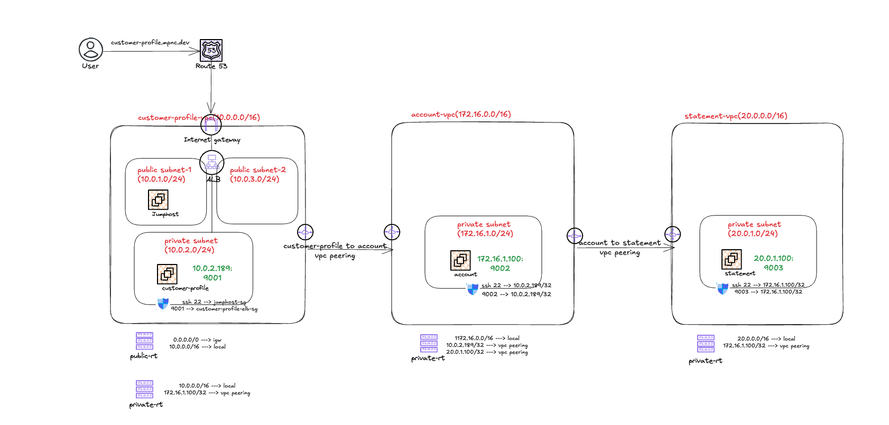

## Data Flow & Communication Chain
1. **User Request:** A user visits `https://customer-profile.mpnc.dev`. **Route 53** resolves the domain, and **AWS Certificate Manager (ACM)** terminates TLS/HTTPS securely at the Application Load Balancer (ALB).
2. **Tier 1 (Customer Profile):** The ALB forwards traffic to the `customer-profile` service running on `10.0.2.189:9001` inside the private subnet of `customer-profile-vpc`.
3. **Tier 2 (Account Service):** Via **VPC Peering (`customer-profile to account`)**, the Customer Profile service makes downstream calls to the `account` service running at `172.16.1.100:9002` inside `account-vpc`.
4. **Tier 3 (Statement Service):** Via a second **VPC Peering connection (`account to statement`)**, the Account service calls the `statement` service running at `20.0.1.100:9003` inside `statement-vpc`.

---
##  Tech Stack

* **Cloud Networking:** Amazon VPC Peering, Route Tables, Internet Gateways (IGW)

  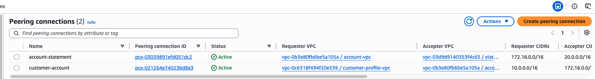

  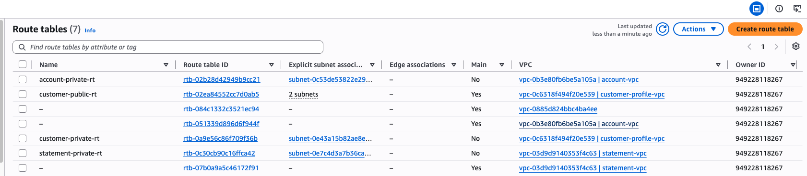
* **DNS & Traffic Routing:** Amazon Route 53 (`mpnc.dev` custom public domain)

  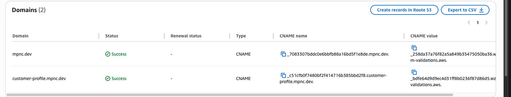
  
* **Security & SSL/TLS:** AWS Certificate Manager (ACM), Security Groups

   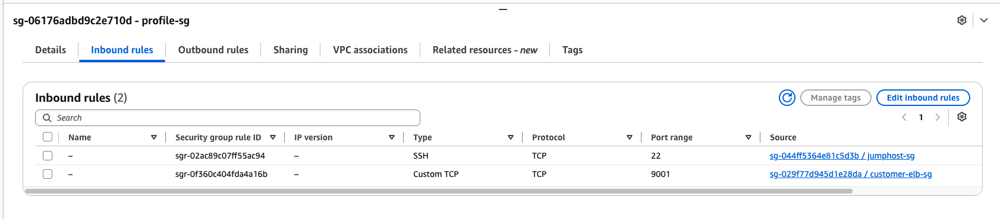

   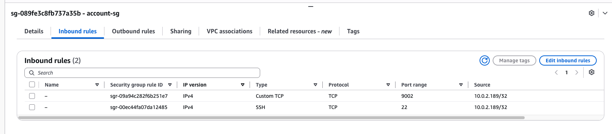

  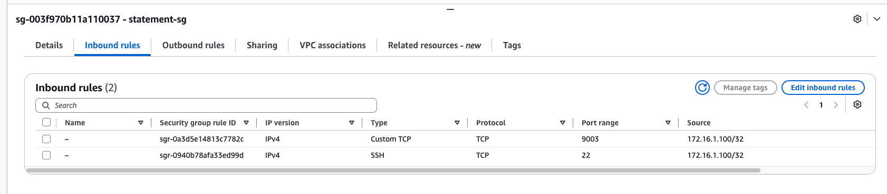
* **Load Balancing:** AWS Application Load Balancer (ALB) with HTTPS listener (Port 443)
* **Compute / Services:** nicholasjackson/fake-service (`customer-profile`, `account`, `statement`) deployed across EC2 instances
* **Access Control:** Jump Host (Bastion) for secure SSH management

   
---

##  Network & Subnet CIDR Design

| VPC Name | VPC CIDR | Subnet Type | Subnet CIDR | Associated Resources |
|---|---|---|---|---|
| **Customer-Profile VPC** | `10.0.0.0/16` | Public Subnet 1 & 2 | `10.0.1.0/24`, `10.0.3.0/24` | Internet Gateway, ALB, Jump Host |
| | | Private Subnet | `10.0.2.0/24` | `customer-profile` service (`10.0.2.189`, Port `9001`) |
| **Account VPC** | `172.16.0.0/16`| Private Subnet | `172.16.1.0/24` | `account` service (`172.16.1.100`, Port `9002`) |
| **Statement VPC** | `20.0.0.0/16` | Private Subnet | `20.0.1.0/24` | `statement` service (`20.0.1.100`, Port `9003`) |

---

##  Security & Route Configurations

* **Route Tables:**
  * `customer-profile-vpc` private route table routes traffic destined for `172.16.1.100/32` across the VPC peering connection.
    
 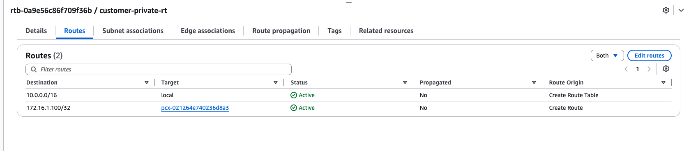
 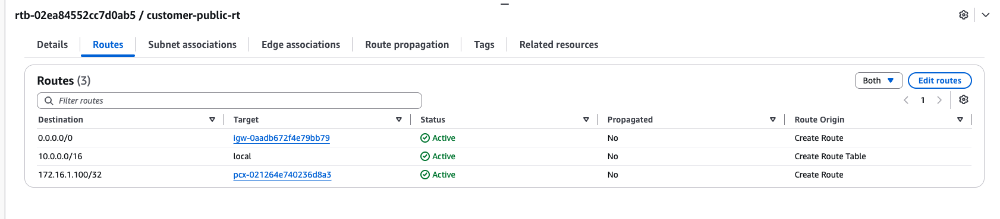
  * `account-vpc` route table allows local traffic (`172.16.0.0/16`), routes customer-profile requests (`10.0.2.189/32`), and communicates with statement service (`20.0.1.100/32`) via peering.
    
 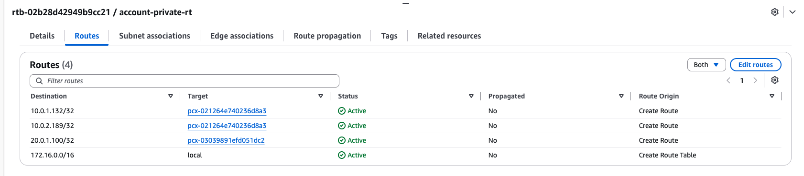
  * `statement-vpc` route table accepts inbound requests from the account service IP (`172.16.1.100/32`) over peering.

  

 
    
* **HTTPS / TLS Encryption:** A public SSL/TLS certificate was provisioned via AWS Certificate Manager (ACM) and bound to the ALB listener on port 443, secured via Route 53 DNS validation.

 
  
  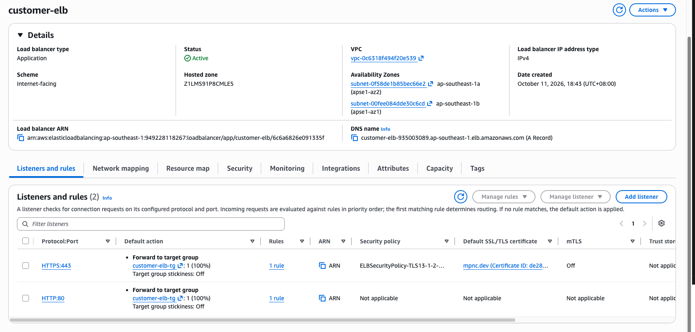
 ---

##  Verification

Accessing `https://customer-profile.mpnc.dev/ui/` in a web browser renders the **Fake Service dependency tree**, confirming successful cross-VPC communication across all three layers in real-time:
1. `Customer Profile` (`10.0.2.189:9001`) 
2. `Account Service` (`172.16.1.100:9002`)
3. `Statement Service` (`20.0.1.100:9003`)
   
 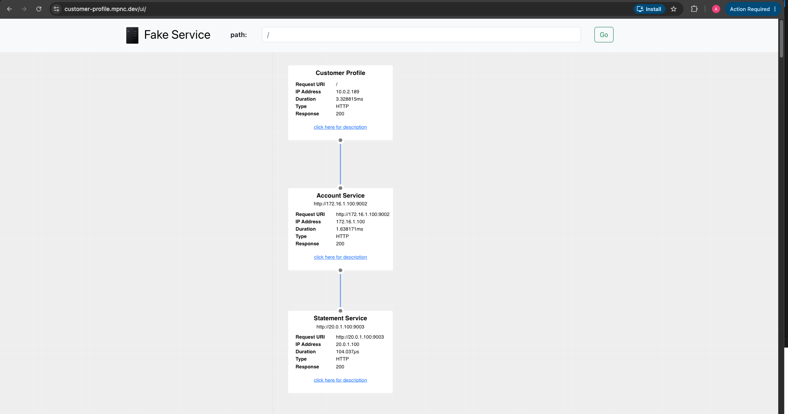
